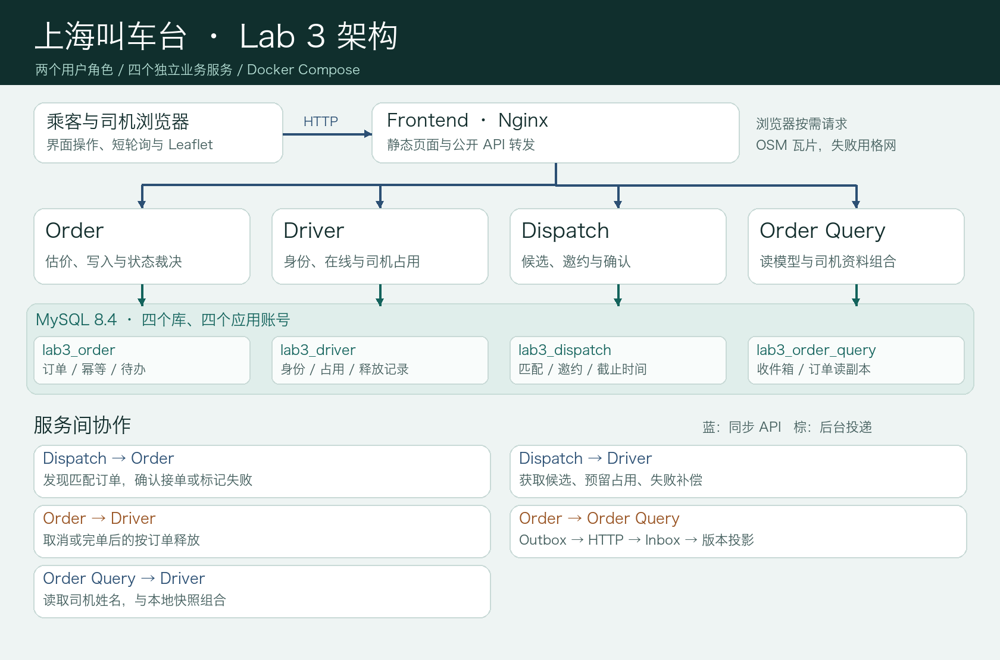
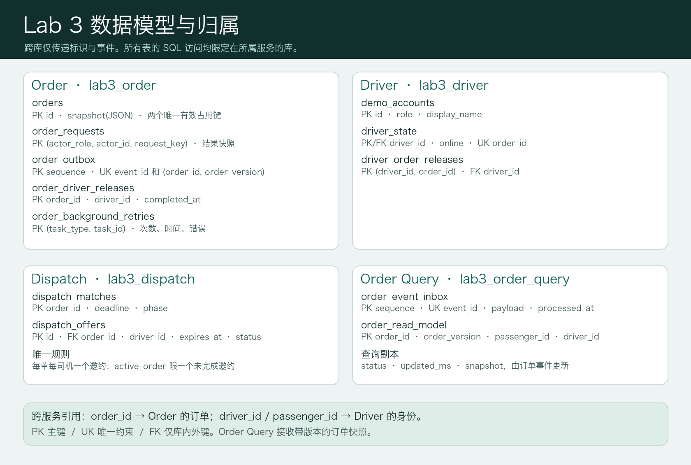

# Lab 3：网约车平台的微服务开发

2026 高级软件工程，第 22 小组。平台演示固定在上海，乘客和司机使用预设账号。从浏览器叫车到完单的订单、派单、占用、查询投影和恢复进度均由实际后端处理。预设地点、直线距离和简化计费属于演示数据。[课程要求](https://openmsg.yuque.com/openmsg/gp3cfs/kyho3e4luti0xo6a)

## 一、业务功能实现

| 阶段 | 页面行为与服务实现 |
| --- | --- |
| 登录与接单状态 | Driver 从自己库中的四个预设账号签发短期 JWT。司机可上线或暂停接单。下线只改变在线标记，已承接订单仍可操作。服务间接口使用单独的 Bearer 凭证。 |
| 选点、估价与叫车 | 乘客选上海预设起终点，Order 校验坐标并用直线距离估算，按 1200 分加每公里 250 分计算。创建订单后返回 `MATCHING`，页面继续查询进度。 |
| 派单与接单 | Dispatch 从 Order 分页发现待匹配订单，从 Driver 查询在线空闲司机。按 ID 依次邀请尚未尝试的候选；无人可用、候选耗尽或总期限到达时写回 `MATCH_FAILED`。接受时须由 Driver 占用并由 Order 确认。 |
| 接驾、上车与结束 | 承接司机在界面确认到达、上车、结束。Order 记录各时点，完成时保存模拟里程和费用摘要。接单后，乘客能看到司机姓名，司机能看到起终点和订单进度。 |
| 取消、重叫与历史 | 上车前乘客可取消自己的订单。取消终止匹配、使旧邀约失效，已占用的司机异步释放。司机界面轮询看到取消。重新叫车使用新幂等键和新订单。乘客可查自己的当前单及终态历史。 |

主链是 `MATCHING → ASSIGNED → ARRIVED → IN_PROGRESS → COMPLETED`。与主链有分支的状态为 `CANCELED` 和 `MATCH_FAILED`。上车后普通取消返回 409，非本人读取或操作返回 403，未认证返回 401。

本轮按单城市和顺序派单收敛。总匹配窗口默认 60 秒，单次邀约最长 15 秒，可通过配置缩短演示时长。司机拒绝或超时后不再邀请该司机处理同一单。乘客与司机均最多绑定一笔有效订单。计费无真实扣款，行程开始和到达以司机按钮确认。

接口见 [Driver](../contracts/driver.md)、[Order](../contracts/order-write.md)、[Dispatch](../contracts/dispatch.md)、[Order Query](../contracts/order-query.md)。

## 二、DDD 四层架构与数据管理

### 服务划分与 Lab2 调整

| Lab2 设计 | Lab3 实现及原因 |
| --- | --- |
| S-02 Ride 负责订单和行程，S-03 Dispatch 提供候选 | Order 保留订单权威与状态机。Dispatch 持久管理匹配、邀约及接单协调；顺序邀请降低演示复杂度，仍保留期限、重试及并发保护。 |
| S-01 Participant 提供身份，Ride 同时维护司机占用 | Driver 提供预设身份、资料、在线和实际占用。Order 仍保留有效乘客与司机唯一索引，确保订单写侧唯一性。两个服务间通过 HTTP 和持久任务协调。 |
| S-08 Operations 维护运营投影 | 本轮不实现完整运营后台，新建独立 Order Query，向乘客与司机提供客户侧读模型与组合查询。 |
| S-04 Pricing、S-05 Location、S-06 Payment、S-07 Notification 各有独立职责 | 将模拟估价合入 Order，以预设地点替代实时定位，以界面轮询体现状态更新，本轮省去真实支付、取消费和推送通知。 |
| RabbitMQ 业务事件、多城市部署 | 本轮固定上海，采用 Compose 内部 HTTP。Order 事务 Outbox、异步投递和 Query 持久 Inbox 保留失败重试与去重能力，减少部署依赖。 |

项目统一使用 Node.js 24。Order、Driver、Dispatch、Order Query 由 Compose 分别构建和运行，每个暴露自己的健康检查。Nginx 提供前端与公开接口路由，MySQL 提供持久化。这两类基础设施独立于四个业务服务的计数。

### Order 的四层与聚合

| 层 | 代码 | 职责 |
| --- | --- | --- |
| 接口 | [interface](../services/order/src/interface) | 解析命令，校验用户和服务身份，生成 HTTP/JSON 响应。 |
| 应用 | [order-service.mjs](../services/order/src/application/order-service.mjs) | 协调估价与命令，规范化输入，生成请求摘要，并通过仓储执行事务。 |
| 领域 | [order.mjs](../services/order/src/domain/order.mjs) | 维护 Order 聚合的身份归属、合法状态、版本、首次生效时点和费用摘要。聚合根由 `orderId` 标识。 |
| 基础设施 | [order-store.mjs](../services/order/src/infrastructure/order-store.mjs)、[order-workers.mjs](../services/order/src/infrastructure/order-workers.mjs) | MySQL 持久化、锁、唯一约束、幂等、Outbox、释放任务和重试。 |

以乘客取消为例，HTTP 层验证 JWT，应用层校验幂等键并进入事务。仓储登记或锁定幂等键，再锁住目标订单行。聚合检查乘客归属及订单仍在可取消阶段，产生带新版本的 `CANCELED` 状态。仓储保存订单快照、幂等结果、Outbox 和必要的司机释放任务。提交后才返回成功，后台负责通知 Query 和 Driver。

### 数据归属

| 服务和专用库 | 权威与副本 |
| --- | --- |
| Order / `lab3_order` | 订单快照和有效订单约束，幂等请求响应、快照 Outbox、司机释放任务与重试进度。乘客和司机的 ID 引用 Driver。 |
| Driver / `lab3_driver` | 预设身份、在线和实际占用，按司机和订单记录释放事实。当前订单 ID 引用 Order。 |
| Dispatch / `lab3_dispatch` | 匹配阶段、截止时间、尝试过的司机与邀约。保存用于展示的订单快照，订单 ID 和司机 ID 只是跨服务引用。 |
| Order Query / `lab3_order_query` | 事件收件与投影进度、按订单版本生成的查询副本。司机资料由 Driver 按需提供。 |

在同一 MySQL 8.4 实例里设四个库和四个受限账号。查询和写命令均只用自己的库。服务间的数据通过 HTTP API 或带版本的异步事件传递，关系图中的跨服务引用不设跨库外键。业务快照、占用、待办和截止时间均可在重启后从数据库读取。

## 三、CQRS 与 API 组合查询

写模型保存完整聚合及当前有效占用约束。读模型按订单 ID 保存最新版本、乘客和司机标识、状态、更新时间和展示快照，分别按乘客和司机索引。乘客历史查询只读本人终态订单，支持游标分页。

1. Order 保存订单的同一事务写入 `OrderSnapshotChanged`。事件包含 `eventId`、`schemaVersion`、`orderId`、`orderVersion`、`occurredAt` 和 `snapshot`。
2. 后台通过内部 HTTP 向 Order Query 投递。Query 保存到独立 Inbox 后确认；Order 收到成功响应才标记投递完成。失败从数据库重试，因此同一事件可能再次到达。
3. Query 后台事务按版本更新读模型，并标记 Inbox 已处理。旧版本和重复版本不能覆盖新版；事务失败时保留未处理项。Query 重启可以继续追赶。
4. 查询详情或当前单时，先从 Query 自己的读库取快照并检查身份。若有司机 ID，再调用 Driver 的 `GET /internal/drivers/{id}`，仅组合返回司机 ID 和姓名。Driver 失败或超时，仍返回基础快照和 `driverProfileStatus: "UNAVAILABLE"`。历史列表直接走查询副本。

具体请求、事件和读写时序见 [Order Query](../contracts/order-query.md) 和[恢复与投递](../contracts/order-recovery.md)。

## 四、自动化测试、前端与系统验证

| 验证 | 实际结果 |
| --- | --- |
| Order 单元级 | 8/8，覆盖估价、状态规则、身份归属及应用层命令。 |
| Order 服务级 | 6/6，运行真实 HTTP 处理器及独立 MySQL 测试库。覆盖完整生命周期、并发重复建单、司机竞争、取消与上车竞争，以及 Outbox 写失败时的事务回滚。 |
| 前端状态测试 | 3/3，覆盖延迟投影、重叫时切换版本以及按角色展示动作。 |
| 集成与恢复 | 派单、恢复、查询脚本通过。实际暂停 Driver 和 Query，再重启 Order 后补做释放和投递；查询退化、乱序拒绝和读写分离均通过。 |
| 浏览器 | 两个独立 Chrome 会话跑通双角色完整流程、刷新恢复、历史和取消后重叫；拦截瓦片请求验证地图降级。 |

复跑命令见 [README](../README.md#order-自动化测试)，配套用例及范围见[两级测试记录](order-testing.md)。本轮集成证据来自 2026-11-24 从 CodeArts 干净克隆的 `87ba79ce0d47700cf2601bf072f9531915ef60f2)。随后合并验收材料的 `b607f704c32b69e1d12ce564a84a91edb60c9784` 仅新增验收文档与证据，不改变运行和测试文件。[验收记录、日志与截图](acceptance.md#实跑结果)

前端通过 Nginx 同源访问公开接口。Leaflet 使用预设 WGS84 经纬度绘制起终点和示意连线，默认底图为 OpenStreetMap，保留署名。瓦片失败时显示本地格网、坐标、行程状态和操作按钮。也可用 `?tiles=off` 现场演示。用浏览器刷新验证服务端状态，与前端页面缓存分开。

`docker compose up -d --build --wait` 启动全套服务。两个乘客、两个司机均为初始化数据，默认司机离线。配置与数据重置方式见 [README](../README.md)。排查时用 `docker compose ps` 检查独立服务状态，再用 `docker compose logs order driver dispatch order-query`，按订单 ID、邀约 ID 或事件 ID 关联操作和重试。演示账号、操作、预期结果及取证位置参见[现场验收步骤](acceptance.md#现场准备)。课程现场展示仍由小组按该步骤完成。

## 五、关键业务挑战与处理

### 5.1 并发接单与司机资源竞争

候选列表只是某一时刻的状态。Driver 在预留时锁司机行并再次检查在线和空闲，同时用 `driver_state.order_id` 的唯一约束避免同一订单并占多名司机。Order 在订单行锁下确认承接，自己库中的有效司机索引也会拒绝司机被绑定到另一笔有效订单。对争抢失败的一方返回冲突；Dispatch 将不可承接的邀约作废，并按规则尝试下一名司机或结束匹配。

顺序派单保证同一订单最多一个未完成邀约。超时依据持久化截止时间，响应时由 MySQL 条件更新判定，过期邀约返回 409。司机看见邀请后如果下线，Driver 会在预留时拒绝，除非是对已经成功占用的同一订单重试。这样可以安全分辨“重试确认”和“尝试新占用”。

### 5.2 服务失败与业务恢复

这里采用持久化的本地事务和补偿。各服务提交自己的数据库，由 Dispatch 与 Order 后台根据持久进度继续执行。

| 故障 | 处理 |
| --- | --- |
| Driver 已占用，Order 未确认 | Dispatch 保存邀约 `ACCEPTING`。Order 明确拒绝后核对权威快照，确定没有承接便按原订单 ID 补偿释放。网络超时保留进度，待下一轮重新确认。 |
| 接单成功但响应丢失 | 重启后继续查看 `ACCEPTING`。权威订单已绑定该司机时确认邀约；仍需确认时使用由邀约 ID 派生的同一幂等键。 |
| 取消或完单已保存，Driver 尚未释放 | Order 在订单事务登记释放任务。后台调用 Driver 并记录完成时间；失败按退避时间继续重试。Driver 只清除当前占用等于原订单的记录。 |
| 邀约等待期间 Dispatch 重启 | 匹配阶段、邀约状态及原截止时间持久化。重启从原记录继续，已到期邀请不会获得新的时间。 |
| 订单已写而事件未发，或 Query 收件后退出 | 用持久 Outbox 重投，查询侧 Inbox 先存再确认。投影与处理标记同一事务；未完成事件可由后台继续。 |

Order 的两条后台任务各自运行，分别记录重试次数、最近错误和下次时间。实际停机验收验证了释放及事件投递同时失败、Order 重启、依赖恢复及补做。持久进度允许依赖长时间不可用时保留任务，避免把未确认结果当成最终成功。

### 5.3 取消、接单与开始行程之间的竞争

取消先提交时，后续确认接单不能把订单改回匹配或已接单。已预留的司机会由补偿释放。接单先提交时，只要乘客尚未上车，取消仍合法，Order 随取消事务保存释放任务。取消与上车争用同一个订单行锁：取消先成功则上车被拒绝，上车先成功则普通取消返回 409。两端以写响应展示本次结果，随后以带版本的查询数据追上最新状态。

### 5.4 重复请求、重复事件与乱序更新

Order 幂等记录按身份、角色和请求键唯一，且比对请求摘要。相同键重试返回原结果，换内容用旧键返回 409。即使换键重复开始、结束等已生效动作，也不会重写首次时点、重复计费或新增版本。重新叫车使用新键和新订单 ID。

事件收件以 `eventId` 去重，投影只接受更高的订单版本，避免旧状态覆盖新状态。邀约绑定原订单和司机，过期或取消的邀约不能确认新订单。释放时 Driver 按原订单条件清理占用，并保留释放记录，避免随后收到的旧预留重新生效。

### 5.5 查询延迟与组合查询失败

写成功时页面先显示返回的新状态和版本。后台约每两秒刷新，查询 404 或查询版本低于页面已确认版本时，保留本次写结果，等读模型追上。司机资料独立查询，超时仍返回订单、起终点和行程状态。页面明确显示司机资料暂不可用，之后刷新可补齐。

## 交付入口

[CodeArts 的独立 lab3 仓库](https://devcloud.cn-north-4.huaweicloud.com/codehub/project/c1aa0a224dba4c2591226b87a5af9407/codehub/3123171/home?ref=master)是课程材料入口。分工及部署见 [README](../README.md)，包含源代码、配置及测试。[总体图](architecture.png)和[数据模型图](data-model.png)与当前实现对应，现场演示步骤可单独打开[验收文档](acceptance.md)。
